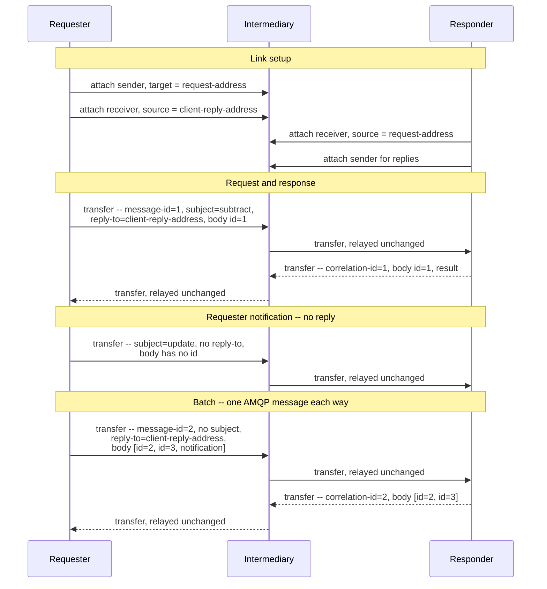

# JSON-RPC 2.0 over AMQP 1.0 -- Binding Specification Version 1.0

## Working Draft 01

## 08 October 2026

Standards Track Work Product. Prepared for a ballot to approve Committee Specification Draft 01
and authorize its first 30-day public review; neither approval nor public review has occurred.

### This Stage

Not yet published. Proposed CSD01 locations, subject to OASIS registration and confirmation:

- Markdown (proposed authoritative format):
  `https://docs.oasis-open.org/amqp/jsonrpc-amqp/v1.0/csd01/jsonrpc-amqp-v1.0-csd01.md`
- HTML: `https://docs.oasis-open.org/amqp/jsonrpc-amqp/v1.0/csd01/jsonrpc-amqp-v1.0-csd01.html`
- PDF: `https://docs.oasis-open.org/amqp/jsonrpc-amqp/v1.0/csd01/jsonrpc-amqp-v1.0-csd01.pdf`

### Previous Stage

N/A. This work product has no approved publication identified in this draft.

### Latest Stage

Not yet published. Proposed latest-stage locations, subject to OASIS confirmation:

- Markdown: `https://docs.oasis-open.org/amqp/jsonrpc-amqp/v1.0/jsonrpc-amqp-v1.0.md`
- HTML: `https://docs.oasis-open.org/amqp/jsonrpc-amqp/v1.0/jsonrpc-amqp-v1.0.html`
- PDF: `https://docs.oasis-open.org/amqp/jsonrpc-amqp/v1.0/jsonrpc-amqp-v1.0.pdf`

### Technical Committee

[OASIS Advanced Message Queuing Protocol (AMQP) TC](https://www.oasis-open.org/committees/amqp/)

### Chairs

- Rob Godfrey (<rgodfrey1@ibm.com>), IBM
- Clemens Vasters (<clemensv@microsoft.com>), Microsoft

### Editors

- Stefan Moser (<stefamos@amazon.com>), AWS
- Vignesh Selvam (<vigselvm@amazon.com>), AWS

### Abstract

This specification defines the representation of JSON-RPC 2.0 messages on AMQP 1.0, including
message bodies, request/reply properties, notifications, batches, and correlation. It applies to
direct connections and to connections through intermediaries.

### Citation Format

**[JSONRPC-AMQP]** *JSON-RPC 2.0 over AMQP 1.0 -- Binding Specification Version 1.0*, OASIS
Advanced Message Queuing Protocol (AMQP) TC, Working Draft 01, 08 October 2026. [Online]. Available:
[TC repository](https://github.com/oasis-tcs/amqp-specs/tree/master/jsonrpc).

### Related Work

This document is related to *MCP over AMQP 1.0 -- Binding Specification Version 1.0* [MCP-AMQP],
which defines an application of this binding.

## License, Document Status, and Notices

Copyright © OASIS Open 2026. All Rights Reserved. For license and copyright information and
complete status, see [Annex A](#annex-a-license-document-status-and-notices).

## Table of Contents

- [1 Scope](#1-scope)
- [2 Definitions](#2-definitions)
- [3 Document Conventions](#3-document-conventions)
- [4 Introduction](#4-introduction)
- [5 Overview](#5-overview)
- [6 Message Mapping](#6-message-mapping)
- [7 Addressing and Topology](#7-addressing-and-topology)
- [8 Delivery](#8-delivery)
- [9 Application Protocols](#9-application-protocols)
- [10 Safety, Security, and Data Protection Considerations](#10-safety-security-and-data-protection-considerations)
- [11 Conformance](#11-conformance)
- [Annex A License, Document Status and Notices](#annex-a-license-document-status-and-notices)
- [Annex B References](#annex-b-references)
- [Appendix 1 Acknowledgments](#appendix-1-acknowledgments)
- [Appendix 2 Changes From Previous Version](#appendix-2-changes-from-previous-version)
- [Appendix 3 Example Message Flow](#appendix-3-example-message-flow)
- [Appendix 4 Open Questions](#appendix-4-open-questions)

## 1 Scope

This specification defines a binding of JSON-RPC 2.0 onto AMQP 1.0 [AMQP-v1.0].

It is not in scope for this specification to define how a requester and a responder manage link
credit, what address forms they use beyond the citation in §7, or any security mechanism beyond the
SASL and TLS mechanisms AMQP already provides. The peers decide settlement policy, and §8
specifies `message-id` as a deduplication key. This specification does not define how a requester
learns that a request went unanswered, or how long it waits before concluding one will not arrive;
Appendix 4 lists both as open.

## 2 Definitions

- **JSON-RPC message** -- Any one of the three forms [JSON-RPC] defines for the wire: a request
  object, a response object, or a batch of either.
- **Requester** -- The container that sends a request or a notification. The Client of [JSON-RPC].
- **Responder** -- The container that answers a request. The Server of [JSON-RPC]. A container may
  be a requester for some requests and a responder for others; the roles apply to a request, not to
  a container.
- **Request link** -- An AMQP link on which a requester sends requests and notifications to a
  responder.
- **Reply link** -- An AMQP link on which a responder sends a requester its responses and any
  further messages an application protocol defines in answer to a request.
- **Request address** -- The AMQP address at which a responder receives requests and notifications.
- **Reply address** -- The AMQP address to which a responder sends each message in answer to a
  request.

## 3 Document Conventions

### 3.1 Key Words

The key words "MUST", "MUST NOT", "REQUIRED", "SHALL", "SHALL NOT", "SHOULD", "SHOULD NOT",
"RECOMMENDED", "NOT RECOMMENDED", "MAY", and "OPTIONAL" in this document are to be interpreted
as described in BCP 14 [RFC2119] [RFC8174] when, and only when, they appear in all capitals,
as shown here.

### 3.2 Typographical Conventions

Monospace text identifies AMQP fields, JSON members, literal values, and protocol identifiers.
References in square brackets identify entries in Annex B. Section references identify sections
of this document unless a referenced document is named explicitly.

## 4 Introduction

JSON-RPC 2.0 [JSON-RPC] is a stateless remote procedure call protocol. It defines request, response,
and notification objects, a batch form, its own correlation identifier, and its own error taxonomy.

Sending JSON-RPC through an intermediary is already common, and implementers solve the same set of
problems separately for each deployment. This document defines a binding of JSON-RPC 2.0 onto AMQP
1.0 [AMQP-v1.0] that specifies one solution to that set of problems, so implementations that
conform to this binding interoperate.

### 4.1 Changes From the Previous Version

Changes and revision history are recorded in Appendix 2.

## 5 Overview

JSON-RPC traffic runs in two directions. A requester sends requests and notifications to the
responder on a request link. A responder sends responses and notifications to the requester on a
reply link. A container in both roles keeps its links in each role independent of its links in the
other. One JSON-RPC message maps to exactly one AMQP message, including batches. A requester and
a responder set the fields that correlate a request with its answers in AMQP `properties` on each
message (§6.2). A requester uses one reply address for however many requests it has in flight, and
uses the same two links whether it attaches directly to a responder or to an intermediary where many
requesters share a request address (§7).

## 6 Message Mapping

### 6.1 Body

One JSON-RPC message maps to exactly one AMQP message. The AMQP message body is a single `data`
section that contains the unchanged JSON-RPC object, or array in the case of a batch, and the
message's `content-type` is `application/json`. The body remains authoritative for method dispatch
and correlation.

The `data` section contains the JSON text octet for octet, and that text MUST be encoded using UTF-8
[RFC8259]. Every field this binding specifies outside the JSON text is in an AMQP section.

### 6.2 Properties

This binding requires the request/response contract to be stated as AMQP `properties` fields, which
intermediaries relay without interpreting, as listed in Table I.

Table I. JSON-RPC Message Properties

| Field | Usage |
| ------- | ------- |
| `message-id` | MUST be set on every message, to a globally unique value the requester has not used before. |
| `reply-to` | MUST be set on every request, to the reply address. MUST NOT be set on a notification. |
| `correlation-id` | MUST be set on every message a responder sends in answer to a request, to the value of that request's `message-id` as received, unaltered in type or representation. Absent on requests and on requester-sent notifications. A responder that cannot determine a request's `id` sets `id: null` in the response body and still sets `correlation-id`. |
| `subject` | Where set, MUST equal the body's `method`. An intermediary MAY route and filter on it. Absent on a response. |
| `content-type` | `application/json` |

A responder MUST retain each request's `message-id` and `reply-to` for as long as it may still
send a message in answer to that request, and MUST take the `correlation-id` and the destination of
each such message from what it retained.

A requester reads whether a message completes a request from the body. Where an application protocol
defines several messages in answer to one request, a response contains `result` or `error` and the
request's `id`, while an intermediate notification contains `method` and does not contain `id`.

### 6.3 Notifications

A notification is a request object without an `id` member, and [JSON-RPC] states that a server MUST
NOT reply to one, including one inside a batch. A responder MUST NOT send any message in answer to a
notification, which it identifies from the body: a request object without `id` (§6.1). A responder
that cannot process a notification stays silent, since [JSON-RPC] does not define a response for
one.

An application protocol MAY define notifications a responder sends to a requester. A responder sends
those on the reply link to the reply address of the request they relate to, setting
`correlation-id` per §6.2.

### 6.4 Batches

[JSON-RPC] §6 defines a batch, in which a requester sends an Array of request objects and the
responder returns an Array of the corresponding response objects. A batch is one JSON-RPC message,
so it is one AMQP message: the Array is the body, and the requester sets `message-id` and
`reply-to` as for a single request. The responder likewise sends the response Array as one AMQP
message with `correlation-id` set. Within a batch, a requester matches each response object to its
request by the body `id`.

`subject` is absent on a batch, which does not have a single method, so an intermediary routing on
`subject` cannot route one; a requester that needs such routing sends its requests individually.

Where every member of a batch is a notification, [JSON-RPC] states that a server MUST NOT return an
empty Array. A responder MUST NOT send an AMQP message in that case, and such a batch is a
notification for the purposes of §6.3. Where the batch is an Array with no members, [JSON-RPC]
states that the response MUST be a single response object, which the responder sends as one AMQP
message with `correlation-id` set.
Where a batch contains both requests and notifications, the response Array contains an entry for
each request and omits the notifications, and the responder still sends it as one AMQP message.

### 6.5 Errors

When a request body is not valid JSON, the responder sends the parse-error response [JSON-RPC]
defines as one AMQP message, setting `correlation-id` to the request's `message-id` and sending it
to the request's `reply-to`. If the request does not contain either field, the responder settles the
delivery and does not send anything.

A receiver detaches the link with `amqp:link:message-size-exceeded` when it gets a message larger
than the `max-message-size` it declared at attach. Rather than send an oversize batch, the layer
that assembled it MAY issue its members as individual messages, each its own AMQP message under its
own `message-id`. A single oversize request or notification cannot be divided this way: it is one
JSON-RPC message (§6.1).

## 7 Addressing and Topology

Every address in this binding is an AMQP address as [AMQP-ADDR] defines it, and is opaque to this
binding: this binding does not use any element of [AMQP-ADDR] beyond a `reply-to` that contains an
address.

Where a responder dispatches a request beyond its own process, it passes the `message-id` and
`reply-to` values §6.2 requires it to retain along with the request.

How a requester obtains a reply address is unconstrained: pre-provisioned, declared over a
container's management interface, or allocated as a dynamic terminus where one is supported.

Where the address in a request's `reply-to` contains a network endpoint, [AMQP-ADDR] §3.2.3
specifies a role for a responder's connection back to the requester in delivering the reply;
Appendix 4 lists what that entails as open.

The transport ends when a peer detaches with the `closed` flag set or the connection is lost. That
does not by itself abandon the requests the requester sent over it. A request whose transfer
completed is unaffected by the requester's absence, and where the reply address outlives the
connection, replies remain there for a requester that attaches again. If a request's transfer did
not complete, the responder did not receive it, so a requester that reissues it sends a new request
rather than the duplicate §8 describes. Which case applies depends on the nodes backing the two
addresses, whose durability this binding does not constrain.

### 7.1 Temporary Reply Nodes

This subsection is non-normative.

Where a peer supports receiver-created dynamic sources, a requester can allocate a temporary reply
queue by attaching its reply receiver with an addressless source whose `dynamic` field is `true`.
The temporary-queue profile in [AMQP-JMS-MAP] supplies the `temporary-queue` capability and a
`lifetime-policy` of `delete-on-close`. The example requests `durable=none` and
`expiry-policy=link-detach`; the peer's attach response determines the node's actual properties.

```amqp
attach(
  name={unique reply-link name},
  role=receiver,
  source={
    durable=none,
    expiry-policy=link-detach,
    dynamic=true,
    dynamic-node-properties={
      :"lifetime-policy"=delete-on-close
    },
    capabilities=[temporary-queue]
  },
  target=null
)
```

On success, the peer's attach response has a source containing the assigned address. The requester
uses that address opaquely: once its receiver is attached and credited, it sets the request's AMQP
`reply-to` to the address. The responder attaches a sender to that address and sets the reply's
`correlation-id` from the request's `message-id` (§6.2). The requester receives and settles replies
on the same link that requested the dynamic source. No second receiver or creating sender link is
needed.

A peer may refuse dynamic source creation or return no usable source address. The requester then
needs another reply-address arrangement before sending requests. It must not assume that an address
assigned to a temporary node survives the reply link's closure or a connection interruption. Even
when the requested lifetime policy is honored, replies sent after the node is deleted cannot reach
the requester through that address.

## 8 Delivery

**Duplicates.** [JSON-RPC] does not define idempotency or deduplication. A responder that needs to
recognize a redelivered request SHOULD check for a repeated `message-id` (§6.2).

**Ordering.** [AMQP-v1.0] specifies ordered delivery between the two endpoints of a link. What an
intermediary preserves beyond one hop is that intermediary's property. Where an application
protocol defines several messages in answer to one request (§6.2), a responder controls only the
order in which it sends them.

## 9 Application Protocols

An application protocol defines its own routing metadata as `application-properties` keys. Such
keys are advisory: an endpoint reads the JSON-RPC body as authoritative, and the keys exist so
intermediaries can route, filter, and meter without decoding it.

Where an application protocol defines cancellation, a requester cancels a request by sending an
ordinary notification on the request link that identifies the request to abandon (§6.3); this
binding does not define a meaning for the notification. Cancellation is instance-affine where the
rest of this binding is not: when many instances serve a request address, an intermediary can
deliver the notification to any one of them, and a requester-sent notification does not contain a
`correlation-id` (§6.2), so an intermediary cannot route it to the instance holding the request by
any field this binding defines. An application protocol that needs stronger delivery than
best-effort defines its own affinity mechanism; Appendix 4 lists the question.

## 10 Safety, Security, and Data Protection Considerations

### 10.1 Security Considerations

The responder sends to the address the requester set in `reply-to`. Two things must hold: the
responder's right to send there, and the requester's entitlement to set that address at all.

**The responder's right to send.** The identity the responder runs under must be permitted to send
to the address the requester set, and the requester must be able to arrange that. Where both parties
share one address space and one authorization authority, the requester provisions its reply address
so the identity or group the responder runs under may send to it. Where the request and reply
addresses are in different address spaces, the mechanisms available differ by deployment;
[AMQP-ADDR] describes one, a reply address with a URI query parameter that contains a token for
limited delegated access.

**The requester's entitlement to set the address.** The system must be able to establish that the
requester was entitled to set that address at all. Absent that, a requester can make a responder
send traffic to any destination, and the responder becomes a relay. This is the likelier interop
hurdle: containers differ widely in what a sender may do with an address it names rather than
attaches to, so a rule stated in terms of one container's model does not apply to another. Appendix
4 lists the cross-address-space case as open.

`subject` is not a security boundary. §6.2 requires it to contain the `method` of its message, but
the sender sets it, and an intermediary cannot detect a divergence from the body without the parse
`subject` exists to avoid. Routing, filtering, and metering are unaffected by a forged value; an
authorization decision MUST NOT be taken on `subject`. The same holds for the
`application-properties` keys §9 describes.

### 10.2 Safety and Data Protection Considerations

This binding defines no additional safety or data protection mechanism. Its security scope is
stated in §1; application protocols and deployments determine the treatment of their payloads.

## 11 Conformance

A **requesting container** conforms to this binding if it:

1. sets `message-id` and `reply-to` on every request as §6.2 requires;
2. correlates each reply it receives to a request by `correlation-id`;
3. does not expect a reply to a notification, per §6.3.

A **responding container** conforms to this binding if it:

1. sets `correlation-id` on every message it sends in answer to a request, as §6.2 requires;
2. does not send anything in answer to a notification or to an all-notification batch, per §6.3 and
   §6.4;
3. omits `subject` from every response and every batch it sends, as §6.2 and §6.4 require.

Both roles use the body and batch forms as §6.1 and §6.4 require, and preserve [JSON-RPC] semantics
end to end, with one departure: a responder may answer a request with more than one message where an
application protocol defines it (§6.2), which [JSON-RPC] does not permit. Neither role is required
to answer every request; this binding does not define how a requester learns that a request went
unanswered (§1).

## Annex A License, Document Status and Notices

(This annex forms an integral part of this Specification.)

### A.1 Document Status

This document was last revised by the OASIS Advanced Message Queuing Protocol (AMQP) TC on the
above date. It is a Working Draft and has not been approved as a Committee Specification Draft.
The product registration, publication URIs, and authoritative format remain
subject to TC and OASIS Administration confirmation. Other technical work produced by the TC is
listed at <https://www.oasis-open.org/committees/amqp/>.

TC members should send comments to the TC's general email list. Others should use the
[TC's public comment facility](https://groups.oasis-open.org/communities/community-home?communitykey=f83ec4e4-c2ad-4e1f-b9d2-018f5aa7a390)
after obtaining access through the [comment signup form](https://www.oasis-open.org/comment-signup/)
and accepting the OASIS Feedback License. Public comments are not accepted through GitHub.

Any machine-readable content (Computer Language Definitions) declared Normative for this Work
Product is provided in separate plain text files. In the event of a discrepancy between any such
plain text file and display content in the Work Product's prose narrative document(s), the content
in the separate plain text file prevails. This draft contains no such separate normative artifacts.

### A.2 License and Notices

Copyright © OASIS Open 2026. All Rights Reserved.

All capitalized terms in the following text have the meanings assigned to them in the OASIS
Intellectual Property Rights Policy (the "OASIS IPR Policy"). The full Policy, which governs the
licensure of this document, may be found at the OASIS website:
<https://www.oasis-open.org/policies-guidelines/ipr/>.

This document and translations of it may be copied and furnished to others, and derivative works
that comment on or otherwise explain it or assist in its implementation may be prepared, copied,
published, and distributed, in whole or in part, without restriction of any kind, provided that the
above copyright notice and this section are included on all such copies and derivative works.
However, this document itself may not be modified in any way, including by removing the copyright
notice or references to OASIS, except as needed for the purpose of developing any document or
deliverable produced by an OASIS Technical Committee (in which case the rules applicable to
copyrights, as set forth in the OASIS IPR Policy, must be followed) or as required to translate it
into languages other than English.

The limited permissions granted above are perpetual and will not be revoked by OASIS or its
successors or assigns, as provided in the OASIS IPR Policy.

This document is provided under the RF on RAND IPR mode that was chosen when the project was
established, as defined in the IPR Policy. For information on whether any patents have been
disclosed that may be essential to implementing this document, and any offers of patent licensing
terms, please refer to the [Intellectual Property Rights section of the TC's web page](https://www.oasis-open.org/committees/amqp/ipr.php).

This document and the information contained herein is provided on an "AS IS" basis and OASIS
DISCLAIMS ALL WARRANTIES, EXPRESS OR IMPLIED, INCLUDING BUT NOT LIMITED TO ANY WARRANTY THAT THE
USE OF THE INFORMATION HEREIN WILL NOT INFRINGE ANY OWNERSHIP RIGHTS OR ANY IMPLIED WARRANTIES OF
MERCHANTABILITY OR FITNESS FOR A PARTICULAR PURPOSE. OASIS AND ITS MEMBERS WILL NOT BE LIABLE FOR
ANY DIRECT, INDIRECT, SPECIAL OR CONSEQUENTIAL DAMAGES ARISING OUT OF ANY USE OF THIS DOCUMENT OR
ANY PART THEREOF.

The name "OASIS" is a trademark of OASIS, the owner and developer of this document, and should be
used only to refer to the organization and its official outputs. OASIS welcomes reference to, and
implementation and use of, its documents, while reserving the right to enforce its marks against
misleading uses. Please see <https://www.oasis-open.org/policies-guidelines/trademark/> for guidance.

## Annex B References

(This annex forms an integral part of this Specification.)

Normative references identify the specific editions used by this binding. Informative references
provide context and are not required to implement this binding.

### B.1 Normative References

- **[AMQP-v1.0]** *OASIS Advanced Message Queuing Protocol (AMQP) Version 1.0*, OASIS Standard,
  29 October 2012. [Online]. Available:
  <https://docs.oasis-open.org/amqp/core/v1.0/os/amqp-core-complete-v1.0-os.pdf>.
- **[AMQP-ADDR]** *AMQP Addressing Version 1.0*, Committee Specification Draft 01,
  17 March 2021. [Online]. Available:
  <https://docs.oasis-open.org/amqp/addressing/v1.0/csd01/addressing-v1.0-csd01.html>.
- **[JSON-RPC]** *JSON-RPC 2.0 Specification*, 26 March 2010, revised 04 January 2013.
  [Online]. Available: <https://www.jsonrpc.org/specification>.
- **[RFC8259]** T. Bray, *The JavaScript Object Notation (JSON) Data Interchange Format*,
  RFC 8259, December 2017. [Online]. Available: <https://www.rfc-editor.org/info/rfc8259>.
- **[RFC2119]** S. Bradner, *Key Words for Use in RFCs to Indicate Requirement Levels*, BCP 14,
  RFC 2119, March 1997. [Online]. Available: <https://www.rfc-editor.org/info/rfc2119>.
- **[RFC8174]** B. Leiba, *Ambiguity of Uppercase vs Lowercase in RFC 2119 Key Words*, BCP 14,
  RFC 8174, May 2017. [Online]. Available: <https://www.rfc-editor.org/info/rfc8174>.

### B.2 Informative References

- **[AMQP-JMS-MAP]** *AMQP Bindings and Mappings for JMS Version 1.0*. OASIS AMQP Technical
  Committee, Working Draft 10, 21 August 2020. [Online]. Available:
  <https://groups.oasis-open.org/higherlogic/ws/public/download/67638/amqp-bindmap-jms-v1.0-wd10.pdf>.
- **[MCP-AMQP]** *MCP over AMQP 1.0 -- Binding Specification Version 1.0*, OASIS Advanced
  Message Queuing Protocol (AMQP) TC, working draft. [Online]. Available:
  <https://github.com/oasis-tcs/amqp-specs/tree/master/mcp>.

## Appendix 1 Acknowledgments

(This appendix does not form an integral part of this Specification and is informational.)

Stefan Moser contributed the binding drafts recorded in the TC repository. This acknowledgment
does not designate a work product editor.

## Appendix 2 Changes From Previous Version

(This appendix does not form an integral part of this Specification and is informational.)

### Revision History

Newest first. One line per revision; the commit history of this file contains the detail.

Table II. Revision History

| Date | Change |
| ------ | -------- |
| 2026-10-08 | Prepare Working Draft 01 using the OASIS Markdown master template; add cover metadata, conventions, status and notices; reorganize references and informative appendices; renumber sections and update internal references. Protocol requirements are unchanged. |
| 2026-09-25 | Add non-normative guidance for receiver-created temporary queue reply nodes. |
| 2026-09-17 | Correct statements attributed to [JSON-RPC], [AMQP-v1.0] and [RFC8259] that those specifications do not make; resolve the contradictions on `message-id` reuse and on `correlation-id` presence; require UTF-8 in §6.1 rather than through a `content-type` parameter [RFC8259] declines to define; and remove justification from the normative sections. |
| 2026-08-24 | First draft submitted to the Technical Committee for discussion, following the 2026-08-11 meeting's agreement to propose a JSON-RPC binding with [MCP-AMQP] as an application of it. |

## Appendix 3 Example Message Flow

(This appendix does not form an integral part of this Specification and is informational.)

A minimal flow through an intermediary is shown in Fig. 1: link setup, one request answered by one response, one
notification in each direction, and one batch. Addresses are shown as placeholders; their format is
container-specific. Only the fields relevant to the binding are shown.

Fig. 1. Example Message Flow



The intermediary relays each transfer unchanged. Delete it and the direct case remains, with the
requester's links attached to the responder and the requester and responder setting the same
`properties` fields. The batch response Array contains two entries for three members, since the
responder does not answer the notification in the batch. The responder also does not send an AMQP
message in return for the requester's own notification.

## Appendix 4 Open Questions

(This appendix does not form an integral part of this Specification and is informational.)

Questions recorded for Technical Committee discussion are listed in Table III.

Table III. Open Questions

| Question | Detail |
| ---------- | -------- |
| Body section type | §6.1 requires a `data` section and a `content-type` of `application/json`. Reviewers raised two alternatives. An `amqp-value` that contains a string is also restricted to UTF-8 and contains the JSON octets unchanged, differing from `data` only in section type; on this reading the choice is which section a requester uses by default. An `amqp-value` that contains a map is more compact, and most AMQP client libraries encode a JSON object into one without the application asking, but it loses fidelity: after the round trip through AMQP types, an omitted `params` member and a null one are indistinguishable, as are an absent `id` and `id: null`, which is the distinction between a request and a notification, and a JSON number can map to more than one AMQP numeric type. If the binding permits more than one representation, it must name which is canonical for interoperation, say what a responder does with one it did not expect, and state what `content-type`, if any, accompanies each. |
| Batching model | §6.4 specifies a batch as one AMQP message to preserve the semantics [JSON-RPC] defines for the batch as a whole. Reviewers noted that AMQP peers transfer many messages in rapid succession and settle them asynchronously, so a binding could instead map each member of a batch to its own AMQP message, and the batch form would not appear on the wire at all. A binding that did so would trade those semantics and the single batched response for per-message settlement and routing, and would change how an all-notification batch, a batch-level parse error, and an oversize batch (§6.5) are represented. Whether to keep the batch as one message or decompose it is open. |
| Exactly-once effects | §8 specifies `message-id` as a deduplication key and states that a responder SHOULD check for a repeated one, but does not require it to suppress duplicates. Whether the binding should require duplicate suppression is open, as is whether peers can rely on AMQP settlement state more than this draft assumes. Since a `message-id` is never reused, the open quantity is how long a responder must remember one to recognize a redelivery. |
| Failure signalling | A responder sends a JSON-RPC error as a response, which keeps the taxonomy in [JSON-RPC]. Open: whether a requester should synthesize a JSON-RPC error from a `rejected` or `released` disposition, and with what code from the -32000 to -32099 implementation-defined band; and whether the binding should say anything about how long a requester waits for a response that never arrives, which §1 currently leaves to the application protocol. |
| Cancellation affinity | §9 states that cancellation is best-effort where a request address is served by many responder instances, since this binding does not define a field on which an intermediary could route a notification to the instance holding the request. Whether the binding should define an affinity mechanism, or an address a responder publishes for messages concerning a request in progress, is open. |
| Multi-message response signalling | Under §6.2 a requester reads terminality from the body, and this binding does not define a `properties` field for it. Reviewers raised two candidates for the case where an application protocol defines several messages in answer to one request. If a responder set the same `group-id` on those messages, a container that pins a group to one consumer could keep them together, giving a multi-message answer affinity. With an explicit end-of-response marker, a requester could recognize the last message without parsing the body. A binding that adopted either would move work into `properties` at the cost of a field this binding does not currently require, and one that defined an end marker would need to state how a responder sends it alongside the final response. |
| Reply-path authorization | §10 states the problem. This draft does not specify an answer for the cross-address-space case. |
| Reply delivery across address spaces | §7 cites [AMQP-ADDR] §3.2.3 for a `reply-to` that contains a network endpoint. That clause requires (SHOULD) delivery over the connection the request arrived on and an outbound connection to the endpoint only on failure, but does not say what a responder does when the endpoint names a container other than the one the request arrived through: whether a paired-link handshake to that container's `$me`, delivery annotations that contain a return path, or something else applies. Whether this binding should say more than [AMQP-ADDR] does for that case is open. |
